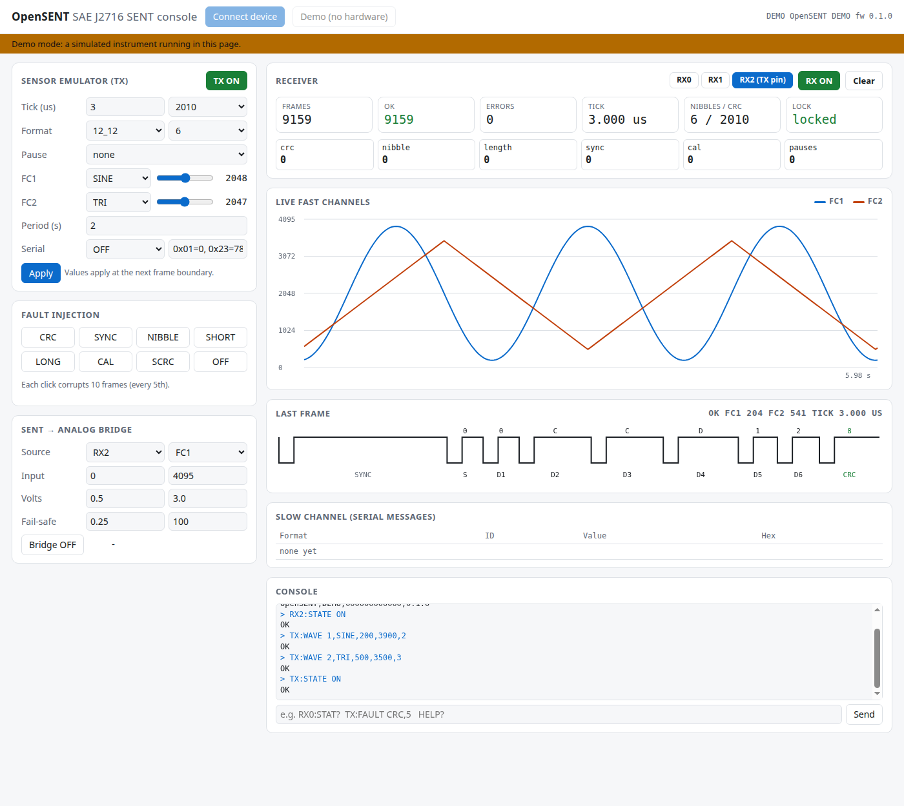
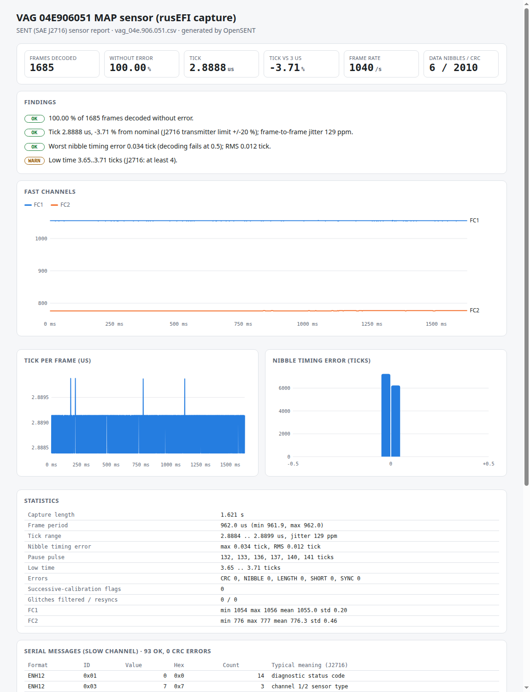
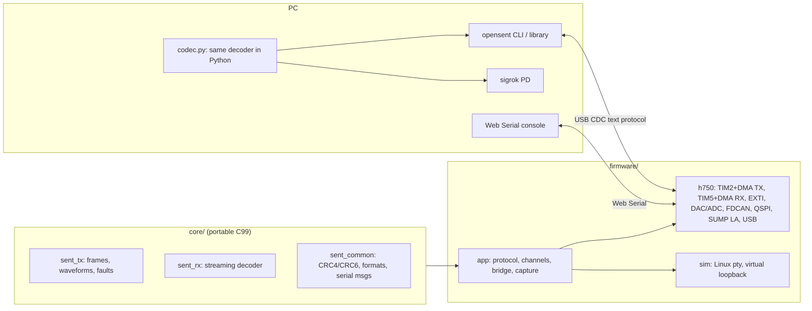

# OpenSENT

**Open-source SAE J2716 SENT toolkit: sensor emulator, bus analyzer, PulseView decoder and SENT → analog bridge, on a low-cost STM32H750 board.**

SENT (Single Edge Nibble Transmission) is how modern sensors talk to the ECU: electronic throttle bodies, pedal sensors, GDI fuel pressure, MAP and EGT sensors, and more. The tools that speak it (Vector, Intrepid, PicoScope options, dedicated SENT interfaces) cost from hundreds to thousands of dollars. Aftermarket ECUs mostly cannot read SENT at all. That is why people swapping a modern engine end up buying closed "SENT to analog" converter boxes.

OpenSENT puts the whole workflow on one WeAct STM32H750 core board and a USB cable:

| | |
|---|---|
| **Sensor emulator** | Generates bit-exact SENT frames on a pin: tick 0.5–100 µs, 1–8 data nibbles, all three CRC variants, pause pulses (fixed / constant frame length), short and enhanced serial messages, waveforms (sine, triangle, ramp, square, counter) to simulate a moving throttle, and **fault injection** (CRC, sync, nibble range, missing / extra nibble, calibration drift, serial CRC). |
| **Analyzer** | 2 independent input-capture receivers at 5 ns resolution, plus a monitor of the TX pin. Decodes fast channels, short / enhanced serial messages, and learns nibble count and CRC variant. Checks successive-calibration drift (1/64 rule), reports tick deviation and nibble timing margin, and keeps error statistics per type. |
| **SENT → CAN gateway** | Sends the decoded values on CAN (FDCAN, 11-bit ID, configurable rate and bitrate) with a valid flag, error count, counter and data age, so an ECU or logger with a CAN input can use a SENT sensor. |
| **Logic analyzer** | A second USB port speaks the SUMP / Openbench Logic Sniffer protocol: 16 channels, up to 33.3 MS/s, 128 K samples, parallel trigger. It works with the stock PulseView / sigrok `ols` driver, so the same board probes the SENT line and the rest of the ECU harness. |
| **Raw capture** | Two-edge capture of a SENT line, exported as VCD/CSV for PulseView. |
| **PulseView decoder** | A SENT protocol decoder for sigrok / PulseView (libsigrokdecode does not ship one). |
| **SENT → analog bridge** | Maps a decoded fast channel to a DAC voltage (0–3.3 V, scalable to 0–5 V), with a fail-safe voltage on sensor loss. It lets an aftermarket ECU read a SENT-only sensor. The output is measured back on chip. |
| **Standalone mode** | A startup script stored in the board's QSPI flash brings the bridge, gateway or emulator up at power-on without a PC. A 0.5 s hardware watchdog turns every output off if the firmware ever hangs. |
| **Sensor health report** | `opensent report` turns a capture (from the board or a logic-analyzer file) into an HTML page. It covers tick accuracy and jitter, nibble timing margin, low time, frame rate, error breakdown, signal plots, and the serial messages with their usual J2716 meaning. |
| **Tools** | Python CLI and library, an offline decoder for logic-analyzer exports, a Web Serial console (no install), and a host simulator for development without hardware. |



## Verified on real hardware

All of this was verified, not just written. The self test runs against the board (or the simulator) with **no external wiring**:

```text
$ opensent selftest
OpenSENT self test on /dev/ttyACM0 (WeAct-H750), channels RX2
  PASS  RX2 sequence (no lost frames)      frames=2466 bad=0 gaps=0
  PASS  RX2 tick 3 us                      frames=661 ok=661 errs=0 tick=3000.0ns (0.000%)
  ...   (3, 4.5, 6, 10, 25, 50, 90 us; sensor clock +/-18 %; CRC 2010/LEGACY/STATUS auto-detect;
         3/4/8 nibbles; pauses 12, 56, 300, 768, constant frame; SHORT/ENH12/ENH16 serial messages)
  PASS  RX2 fault CRC detected             crc=8 (expected 8) other_errs=0
  PASS  RX2 fault SYNC detected            sync=8 (expected 8) other_errs=0
  PASS  RX2 fault CAL detected             cal=16 (expected 16) other_errs=0
  PASS  bridge FC1=2048 -> 1.750 V         commanded=1.7503 measured=1.7507 state=OK
  PASS  bridge fail-safe on sensor loss    commanded=0.2500 measured=0.2491 state=FAIL
  PASS  CAN gateway frames (loopback)      id=0x5A0 len=8 data=04D20C8A8000F001, 200 frames/s, drops=0
  PASS  CAN gateway flags sensor loss      id=0x5A0 len=8 data=0000000000000F97
  PASS  LA 33.3 MS/s timing (1 MHz test signal) run lengths {16: 1200, 17: 2399}, mean 16.667 (expected 16.667)
  PASS  LA capture of the SENT pin decodes frames=14 gaps=0
  PASS  watchdog reset + autostart from flash store=QSPI:EF4017 lines=5 bytes=86 boot=ran; fc1=777 bridge=0.6262,OK,0.6255
  PASS  RX2 capture -> PC decode           edges=4000 frames=221 ok=221 gaps=0 low=5.00 ticks
  PASS  RX0 capture path (pull bit-bang)   frames=299 ok=299 in-order=True tick=4998.8ns
  PASS  RX1 capture path (pull bit-bang)   frames=299 ok=299 in-order=True tick=4998.8ns
PASS: 48/48 checks passed
```

How it works without wires:

- **RX2** decodes the real TX pin level through EXTI.
- **RX0 / RX1** (the input-capture receivers for real sensors) are exercised by bit-banging SENT frames on their own unconnected pins through the internal pull-up / pull-down resistors.
- **The bridge** output is read back by ADC2, which is internally connected to the DAC.
- **The CAN gateway** runs through the FDCAN internal loopback.

The decoder is also validated on **real sensor captures** published by the rusEFI project (`tools/fetch_captures.sh`):

| Sensor | Frames | OK | Detected |
|---|---|---|---|
| GM GDI fuel pressure | 2115 | 100 % | 6 nibbles, CRC 2010, 2 enhanced serial IDs |
| Opel throttle body (idle / moving) | 4717 / 3071 | 100 % | CRC **legacy** |
| VAG 04E906051 MAP | 1685 | 100 % | 140-tick pause, 25 enhanced serial IDs |
| Mercedes A0009053101 EGT | 861 | 100 % | constant frame length |
| Ford throttle (idle / closed) | 903 / 1139 | 95 % / 98 % | capture contains edge glitches |

The C core and the Python port decode these files to **identical frame lists** (checked by the test suite).

## Hardware

A **WeAct Studio STM32H750VBT6 core board**: 400 MHz Cortex-M7, USB-C, ST-Link (SWD) header.

| Function | Pin | Peripheral |
|---|---|---|
| SENT TX (sensor emulator) | **PB10** | TIM2_CH3 PWM, period streamed by DMA (5 ns steps) |
| SENT RX0 | **PA0** | TIM5_CH1 input capture + DMA |
| SENT RX1 | **PA1** | TIM5_CH2 input capture + DMA |
| RX2 (monitor) | PB10 | EXTI10 timestamped with TIM5 |
| Bridge out 1 / 2 | **PA4 / PA5** | DAC1 OUT1/OUT2, read back by ADC2 |
| CAN RX / TX | **PD0 / PD1** | FDCAN1 (with an external transceiver) |
| Logic analyzer | GPIOB (default) | channels 0–15 = PB0–PB15; test signal on PB0/PB1 |
| USB | PA11/PA12 | OTG FS, two CDC ports: control + SUMP logic analyzer |
| LED | PE3 | |

Connecting to real 5 V SENT devices takes two resistors and an op-amp. [docs/hardware.md](docs/hardware.md) covers the level shifting, the open-drain TX with a 5 V pull-up, and the 0–5 V bridge output.

## Quick start

```bash
# firmware (arm-none-eabi-gcc; CMSIS and TinyUSB are fetched automatically)
cmake -S firmware/h750 -B build-h750 -G Ninja && cmake --build build-h750
st-flash --reset write build-h750/opensent.bin 0x08000000

# PC tools
pip install -e host
opensent list
opensent selftest
```

Emulate a throttle sensor that sweeps and sends serial messages:

```bash
opensent tx --tick 3 --wave 1,SINE,200,3900,2 --wave 2,TRI,500,3500,3 \
            --slow ENH12 --msg 0x01=0 --msg 0x23=786 --on
opensent monitor --ch 2 --every 50
```

Read a real sensor on PA0, bridge throttle position to 0.5–3.0 V, and fall back to 0.25 V if the sensor is lost:

```bash
opensent bridge 1 --ch 0 --sig FC1 --in 0 4095 --out 0.5 3.0 --fail 0.25 100
```

Make it standalone (the configuration is stored in flash and runs at power-up; hold K1 to skip it):

```bash
opensent autostart --set "RX0:STATE ON" "BRIDGE1:MAP RX0,FC1,0,4095,0.5,3.0" "BRIDGE1:STATE ON" --run
```

Put a SENT sensor on CAN (500 kbit/s, ID 0x5A0, every 10 ms):

```bash
opensent can --map 0 0x5A0 --period 10 --bitrate 500000
```

Decode a logic-analyzer export (Saleae CSV or VCD) with no hardware:

```bash
opensent decode capture.csv --errors
```

Get a health report of a sensor (live, or from a capture file):

```bash
opensent report --ch 0 -o throttle.html
opensent report tests/data/vag_04e.906.051.csv -o vag.html
```



Capture a real line and open it in PulseView:

```bash
opensent capture --ch 0 --edges 8000 -o sensor.vcd
cp -rL sigrok/sent ~/.local/share/libsigrokdecode/decoders/   # install the decoder
pulseview sensor.vcd                                           # add the "SENT" decoder
```

Use it as a 16-channel logic analyzer in PulseView (Openbench Logic Sniffer driver, second serial port), or from the command line:

```bash
sigrok-cli -d ols:conn=/dev/ttyACM1 --config samplerate=10m --samples 100000 -P sent:data=10 -A sent=fc1
```

Open `web/index.html` in Chrome or Edge, then click **Connect device**, or click **Demo** to try it without hardware.

## Architecture



- **One decoder, two languages.** `core/sent_rx.c` runs on the MCU and in native tests. `host/opensent/codec.py` is a line-by-line port used by the CLI and the PulseView decoder, and the test suite checks that both produce the same frames.
- **The decoder works on segments.** It collects the pulses between two sync pulses and decodes them when the next sync arrives. That way it can tell pause pulses apart even when they look like a nibble (12 ticks), look like a sync (56 ticks), or vary in length (constant-frame-length mode). Each nibble is measured against its own frame's sync, as J2716 requires. A glitch filter merges sub-nibble pulses caused by edge ringing.
- **The TX timing is exact.** The pulse period is rewritten by DMA on every timer update. Rounding to 5 ns clocks uses error diffusion, so the average tick is exact even when it is not a whole number of clocks (for example 3.3333 µs).
- **The protocol** is plain text in SCPI style, one reply per line, the same as [ECUStim](https://github.com/gabrielfontini/ECUStim). See [docs/protocol.md](docs/protocol.md).

## Repository

```
core/            portable SENT library (C99)
firmware/app/    instrument application (hardware independent)
firmware/h750/   WeAct STM32H750 port (CMSIS registers + TinyUSB)
firmware/sim/    host simulator behind a pseudo terminal
host/            Python package: codec, device API, CLI, self test, pytest suite
sigrok/sent/     libsigrokdecode protocol decoder
web/             Web Serial console (single HTML file)
tests/           native C tests, real-capture replay
docs/            protocol, hardware, SENT notes
```

## Tests

```bash
cmake -S tests -B build-native && cmake --build build-native && ./build-native/test_sent tests/data
cmake -S firmware/sim -B build-sim && cmake --build build-sim
pip install -e host pytest && pytest host/tests      # includes the self test on the simulator
```

## Notes on SENT that are easy to get wrong

See [docs/sent-notes.md](docs/sent-notes.md). Some highlights:

- There are **three CRC4 variants in the wild**: J2716-2010 (augmented), legacy (non-augmented, e.g. Opel throttle bodies), and status-included. The status-included variant is identical to 2010 whenever the status nibble is 0.
- With the standard 12+12-bit layout, **fast channel 2 is sent least-significant nibble first**.
- **The enhanced serial CRC6** covers the 24 interleaved bits (bit 2, bit 3) of frames 7–18.
- **A 12-tick pause is indistinguishable from a 7th data nibble** when the signal is constant. Configure `RX:NIB` for unusual frame lengths.

## Roadmap

- SPC (master-triggered short PWM code) and ready-made CAN payloads for popular aftermarket ECUs
- PSI5 receiver and emulator on the same board
- KiCad front-end: 5 V SENT interface plus a 0–5 V bridge output stage

## License and credits

MIT. Real sensor captures used for validation come from the [rusEFI](https://github.com/rusefi/rusefi) project (downloaded on demand, not redistributed). SAE J2716 is a standard of SAE International; this project is an independent implementation.
